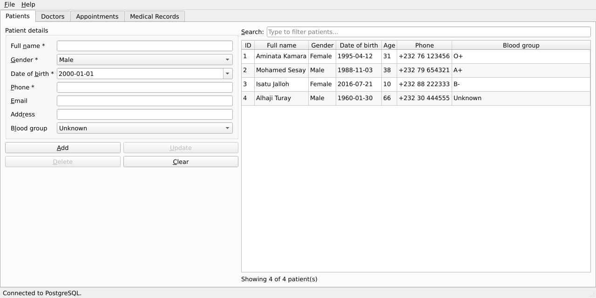
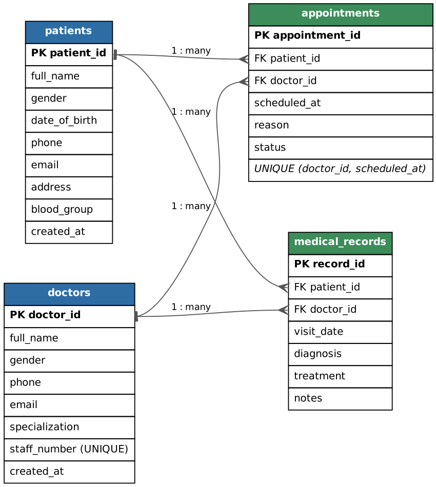

# Patient Record System

A desktop application that lets a small clinic keep **patient details, doctors, appointments and medical records** in one place, instead of paper files.

Built with **Python (OOP)**, **PostgreSQL** and **PyQt6** for PROG211 – Object-Oriented Programming 1, Limkokwing University of Creative Technology, Sierra Leone.



---

## 1. The problem

Many clinics in Sierra Leone still keep patient information on paper cards. Cards get lost, it is hard to see a patient's history, and doctors can be double-booked. This system gives a clinic a simple, free and open-source way to:

- register patients and doctors
- book appointments, without a doctor being double-booked
- record diagnoses and treatments for each visit
- search all records instantly and export them to CSV

## 2. Features

| Screen | What you can do |
|---|---|
| Patients | Add, update, delete and search patients. Age is calculated automatically. |
| Doctors | Manage doctors, their specialization and staff number (e.g. `DOC-001`). |
| Appointments | Book a patient with a doctor and mark the appointment Scheduled, Completed or Cancelled. |
| Medical Records | Record the visit date, diagnosis, treatment and notes for each visit. |
| All screens | Live search, CSV export (Ctrl+E), keyboard shortcuts and clear error messages. |

## 3. Installation

**Requirements:** Python 3.10 or newer, and PostgreSQL 13 or newer.

```bash
# 1. Get the code
git clone <your-repo-url>
cd patient_record_system

# 2. Install the Python packages
pip install -r requirements.txt

# 3. Create the database (or use pgAdmin: right-click Databases > Create)
psql -U postgres -c "CREATE DATABASE patient_records"

# 4. Tell the app how to connect
cp .env.example .env        # Windows: copy .env.example .env
#    then open .env and type your PostgreSQL password

# 5. (Optional) load sample data for a demo
psql -U postgres -d patient_records -f database/schema.sql
psql -U postgres -d patient_records -f database/seed.sql

# 6. Run
python main.py
```

The app creates the tables automatically the first time it runs, so step 5 is only needed for sample data.

## 4. Example usage (sample input / output)

**GUI:** open the *Patients* tab and fill in the form:

| Field | Input |
|---|---|
| Full name | `kadiatu bah` |
| Gender | Female |
| Date of birth | 2001-05-09 |
| Phone | `+232 99 777888` |
| Blood group | B+ |

Click **Add** (or press Ctrl+N). Output: the patient appears in the table as **Kadiatu Bah** (the name is capitalised automatically), with her age calculated. The status bar shows `Patient added: [Patient] Kadiatu Bah (Female) - +232 99 777888 | Age 25, Blood B+`.

**Invalid input:** if the phone number is `abc`, a message explains: *Phone must contain 7-15 digits (e.g. +232 76 123456).* Nothing is saved.

**Double-booking:** if you book a doctor at a time when they already have an appointment, the message is *This doctor already has an appointment at that time.*

**Console demo:** `python demo_console.py` shows every OOP concept without the GUI:

```text
=== 3. Inheritance ===
Patient MRO: Patient -> Person -> Entity -> ABC -> object
Doctor MRO (multiple): Doctor -> Person -> Entity -> ABC -> StaffMixin -> object
Doctor gets staff_badge() from StaffMixin: Staff DOC-001

=== 5. Polymorphism - one loop, different summary() methods ===
Patient        [Patient] Aminata Kamara (Female) - +232 76 123456 | Age 31, Blood O+
Doctor         Dr. Fatmata Conteh - Paediatrics (Staff DOC-001)
Appointment    Appointment 2026-11-14 18:15 for patient #1 [Scheduled]
MedicalRecord  Record 2026-11-01: patient #1 - Malaria
```

## 5. How the OOP requirements are met

| Requirement | Where in the code |
|---|---|
| **Classes & objects** (at least 4) | `Entity`, `Person`, `StaffMixin`, `Patient`, `Doctor`, `Appointment`, `MedicalRecord`, `RecordManager`, `Database`, 4 repositories, 5 GUI classes |
| **Instance methods** | `Appointment.cancel()`, `Doctor.staff_badge()`, `summary()` |
| **Class methods** | `Entity.objects_created()`, `Patient.from_dict()` (alternative constructor) |
| **Static methods** | `Person.is_valid_phone()`, `Person.is_valid_email()`, `Patient.calculate_age()` |
| **Data structures** | `manager.py`: a `dict {id: object}` with add, update, delete, search and display. Lists are used for display. |
| **Tuples (extra credit)** | Fixed values that must not change: `GENDERS`, `BLOOD_GROUPS`, `SPECIALIZATIONS`, `APPOINTMENT_STATUSES` |
| **Encapsulation** | Private `__attributes` with `@property` getters and setters that validate input (e.g. `Patient.blood_group`) |
| **Single inheritance** | `Patient(Person)`, `Appointment(Entity)` |
| **Hierarchical inheritance** | `Person` → `Patient` and `Doctor`; `Entity` → `Person`, `Appointment`, `MedicalRecord` |
| **Multiple inheritance** | `Doctor(Person, StaffMixin)`, `AppointmentsTab(PeopleChoicesMixin, BaseCrudTab)` |
| **super() & overriding** | `Patient.summary()` extends `super().summary()`. Every `__init__` uses `super()`. |
| **Abstract base class** | `Entity(ABC)` declares the abstract methods `validate`, `to_dict` and `summary`. `Person` adds an abstract `role`. `Repository(ABC)` has an abstract `from_row`. |
| **Polymorphism** | `RecordManager.display()` calls `summary()` on any object. Each GUI tab overrides `build_form`, `read_form` and the other hooks. |

## 6. Database design



- `patients`, `doctors`, `appointments` and `medical_records`, with primary and foreign keys
- `CHECK` constraints on gender, blood group, status, and dates (no future dates)
- `UNIQUE (doctor_id, scheduled_at)` prevents double-booking. `UNIQUE staff_number`.
- `ON DELETE CASCADE` removes a patient's appointments and records when the patient is deleted. `ON DELETE RESTRICT` blocks deleting a doctor who still has records.
- Indexes on foreign keys and on patient name
- The views `v_appointments` and `v_medical_records` join in patient and doctor names
- Every query uses psycopg2 parameters (`%s`) and `psycopg2.sql`, which protects against SQL injection

The full schema is in [`database/schema.sql`](database/schema.sql).

## 7. Digital Public Goods (DPG) alignment

This project follows the 9 indicators of the [DPG Standard](https://digitalpublicgoods.net/standard/):

| # | DPG indicator | How this project meets it |
|---|---|---|
| 1 | Relevance to the SDGs | Supports **SDG 3 (Good Health and Well-being)**: better record-keeping in clinics. It also supports SDG 9 by digitising public services. |
| 2 | Open licence | Released under the **MIT Licence** (see `LICENSE`). |
| 3 | Clear ownership | Copyright is held by the project team, as named in `LICENSE` and below. |
| 4 | Platform independence | Uses only open-source dependencies (Python, PostgreSQL, PyQt6, psycopg2). Runs on Windows, macOS and Linux. |
| 5 | Documentation | This README covers installation and usage, and the code has comments throughout. |
| 6 | Data extraction in non-proprietary formats | Any table can be exported to **CSV** (File > Export, Ctrl+E). Data is stored in standard PostgreSQL. |
| 7 | Privacy & applicable laws | Passwords are not stored in the code (they come from `.env`, which `.gitignore` excludes). Only necessary health data is collected. Sample data is fictional. Deleting a patient removes their records. |
| 8 | Open standards & best practices | SQL standard, PEP 8 style, parameterised queries, and validation in both Python and the database. |
| 9 | Do no harm | Deleting anything needs confirmation. Constraints stop bad data. No data is sent anywhere outside the clinic's own database. |

**Accessibility:** every field has a label and an accessible name for screen readers. Fields have tooltips and Alt+letter shortcuts, and every action works from the keyboard (Ctrl+N, Ctrl+S, Del, Esc, F5, Ctrl+E). The default font is larger than usual, and errors are written in plain language.

## 8. Project structure

```text
patient_record_system/
├── main.py                 # starts the app
├── demo_console.py         # OOP demo without the GUI
├── manager.py              # in-memory data structure (dict)
├── models/                 # domain classes (OOP core)
│   ├── entity.py           # abstract base class
│   ├── person.py           # Person (abstract) + StaffMixin
│   ├── patient.py
│   ├── doctor.py           # multiple inheritance
│   └── records.py          # Appointment, MedicalRecord
├── database/
│   ├── db.py               # psycopg2 connection + repositories
│   ├── schema.sql          # tables, constraints, views
│   └── seed.sql            # sample data
├── gui/
│   ├── base_tab.py         # reusable CRUD screen
│   ├── tabs.py             # Patients, Doctors, Appointments, Records
│   └── main_window.py
├── screenshots/
├── requirements.txt
├── .env.example
└── LICENSE
```

## 9. Team

| Name | Student ID | Role |
|---|---|---|
| _Name_ | _ID_ | Models & OOP |
| _Name_ | _ID_ | Database |
| _Name_ | _ID_ | GUI |
| _Name_ | _ID_ | Documentation & testing |
| _Name_ | _ID_ | Report & presentation |

## 10. Licence

MIT. See [LICENSE](LICENSE).
